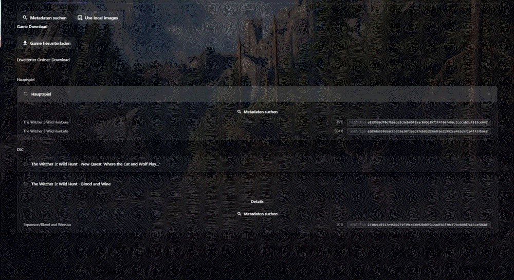
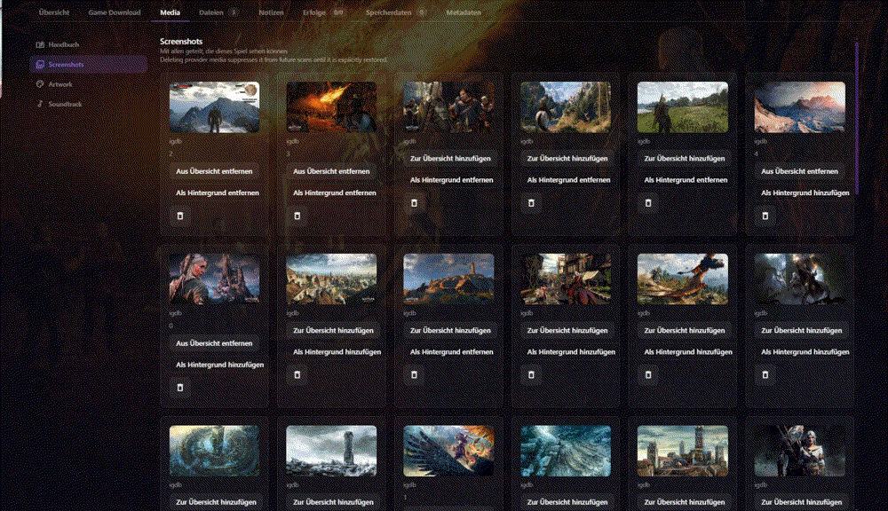

<!-- trunk-ignore-all(markdownlint/MD033) -->
<!-- trunk-ignore(markdownlint/MD041) -->

  

  <h3 style="font-size: 25px;">
    A beautiful, powerful, self-hosted ROM manager and player.
  </h3>

  

    
    
     
    
    
  

# Overview

RomM (ROM Manager) allows you to scan, enrich, browse and play your game collection with a clean and responsive interface. With support for multiple platforms, various naming schemes, and custom tags, RomM is a must-have for anyone who plays on emulators.

## RomM PC Library Edition

This repository is an independent fork of the original [RomM project](https://github.com/rommapp/romm), maintained for this edition by [@D1skanime](https://github.com/D1skanime). It retains RomM's core library experience and adds a PC-library workflow designed around an existing, immutable game archive.

Compared with upstream RomM, this edition adds:

- External PC library roots and platform mappings that are read-only by design. RomM can catalog and serve the archive without changing its files, folders, or organization.
- PC game components, including installers, updates, DLC, optional files, and required archive sets, represented as explicit catalog data.
- Immutable, hash-backed download manifests for selected PC components.
- A browser download manager that delivers original files directly, supports verified resumable transfers where the browser permits it, and never creates whole-game ZIP archives.

These PC-specific extensions are not part of the official RomM project. See the original repository for upstream releases, documentation, and community support.

## Features

- Scan and enhance your game library with metadata from [IGDB][igdb-api], [Screenscraper][screenscraper-api] and [MobyGames][mobygames-api]
- Fetch custom artwork from [SteamGridDB][steamgriddb-api]
- Display your achievements from [Retroachievements][retroachievements-api]
- Metadata available for [400+ platforms][docs-supported-platforms]
- Play games directly from the browser using [EmulatorJS][docs-emulatorjs] and [RuffleRS][docs-rufflers]
- Supports multi-disk games, DLCs, mods, hacks, patches, and manuals
- Parse and filter by [tags][docs-tag-support] in filenames
- View, upload, update, and delete games from any modern web browser

## Interactive UI demos

These short recordings show the fork-specific workflows in the German development UI. They contain only synthetic demo data; ROM files, personal accounts, media libraries, and credentials are not part of the repository.

|                        PC download workflow                        |                       Media and artwork workflow                       |
| :----------------------------------------------------------------: | :--------------------------------------------------------------------: |
|  |  |

The download demo shows the selection dialog and the browser download manager. The media demo shows the screenshots/artwork navigation and the actions for adding artwork to the overview or using it as a background.

## Installation

To start using RomM, check out the [Quick Start Guide][docs-quick-start-guide] in the docs. If you are having issues with RomM, please review the page for [troubleshooting steps][docs-troubleshooting].

For this fork's reproducible NAS deployment, follow the [Portainer installation guide](docs/PORTAINER_INSTALL.md).

## Contributing

To contribute to RomM, please check [Contribution Guide](./CONTRIBUTING.md).

<!-- docs links -->

[docs-quick-start-guide]: https://docs.romm.app/latest/Getting-Started/Quick-Start-Guide/
[docs-supported-platforms]: https://docs.romm.app/latest/Platforms-and-Players/Supported-Platforms/
[docs-emulatorjs]: https://docs.romm.app/latest/Platforms-and-Players/EmulatorJS-Player/
[docs-rufflers]: https://docs.romm.app/latest/Platforms-and-Players/RuffleRS-Player/
[docs-troubleshooting]: https://docs.romm.app/latest/Troubleshooting/Scanning-Issues/
[docs-tag-support]: https://docs.romm.app/latest/Getting-Started/Folder-Structure/#tag-support

<!-- External links -->

[igdb-api]: https://docs.romm.app/latest/Getting-Started/Metadata-Providers/#igdb
[screenscraper-api]: https://docs.romm.app/latest/Getting-Started/Metadata-Providers/#screenscraper
[mobygames-api]: https://docs.romm.app/latest/Getting-Started/Metadata-Providers/#mobygames
[steamgriddb-api]: https://docs.romm.app/latest/Getting-Started/Metadata-Providers/#steamgriddb
[retroachievements-api]: https://docs.romm.app/latest/Getting-Started/Metadata-Providers/#retroachievements
